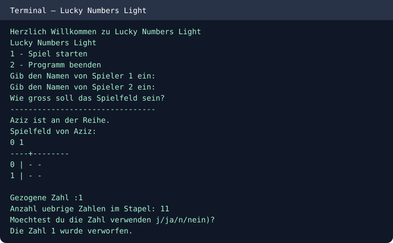

# Lucky Numbers Light — Java

A turn-based console game for two players. Draw numbers from a shuffled stack, then place them on your own grid while preserving ascending order in rows and columns.

## Run
```bash
javac -d out src/*.java
java -cp out Spiel
```

## Features
- Two-player turns
- Grid size between 2 and 10
- Number stack shuffled with Fisher–Yates
- Placement validity checks
- Winner detection

## Console example


Student Java programming project.